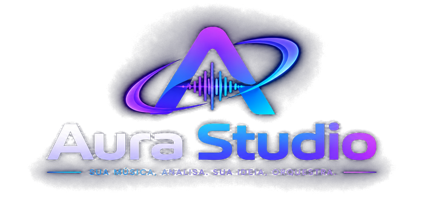
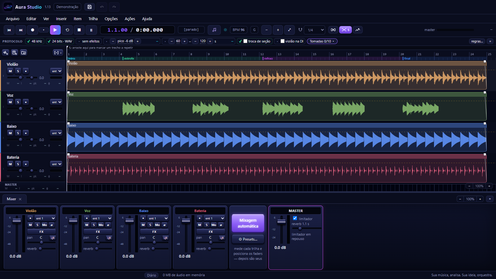
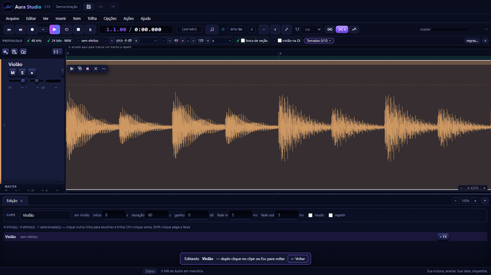

  

<b>Sua música, analisa. Sua ideia, orquestra.</b>

---

**AURA Studio** é um estúdio de gravação para Windows feito para quem compõe
com **violão e voz**. Você grava do jeito que já toca — e o AURA escuta a
música, entende o andamento, a harmonia e a forma, e ajuda a transformar a
ideia em arranjo: escreve a bateria, o baixo, o teclado e as cordas por cima
da sua performance, encaixados nela.

Por baixo, é uma estação de trabalho de áudio completa: gravação multipista,
edição, mixer com efeitos, automação e exportação — com a ergonomia que quem já
usou um programa de gravação reconhece de cara.

## O que o AURA faz

**Gravar**
- Gravação multipista pela sua interface de áudio (ASIO e WASAPI), com
  pré-contagem e metrônomo.
- Protocolo de gravação: o AURA confere cada tomada — nível, duração, trocas de
  seção — e avisa na hora o que precisa de atenção.
- Ouvir-se pelo AURA ou pelo monitor direto da interface, com aviso de atraso.

**Editar**
- Linha do tempo com compassos, clipes que se arrastam, cortam, aparam e se
  emendam com crossfade automático.
- Zoom até ver a onda amostra por amostra, para cortes e emendas precisos.
- Dois cliques no clipe abrem a edição na mesma janela.

**Mixar**
- Mixer com volume, pan, solo, mudo e envio de reverb por trilha.
- Efeitos próprios — equalizador, compressor, gate de ruído, reverb e limitador
  — e plugins VST3.
- Linhas de automação desenhadas sobre a onda: volume, pan, reverb e gate.
- Medição de loudness (LUFS), pico e fase em cada trilha e no master.
- Mixagem automática: o AURA mede cada trilha e posiciona os faders.

**Escutar e arranjar**
- Análise da música: andamento vivo, tonalidade, harmonia funcional,
  estrofes e refrões, e a melodia da voz — frases, respirações e timing.
- Geração da banda a partir da sua gravação: bateria, baixo, teclado e cordas
  que acompanham a sua levada e respondem à sua voz.
- Produção automática em um clique: escuta, banda, mixagem e master.

**Exportar**
- Mix, trilhas separadas (stems), MIDI e mapa de tempo, com o loudness medido.

**Em 9 idiomas:** português, inglês, espanhol, francês, alemão, italiano,
japonês, chinês e coreano.

## Situação

O AURA Studio está **em desenvolvimento ativo** e ainda não tem uma versão
pública para baixar. Esta página acompanha as novidades.

**Requisitos previstos:** Windows 10 ou 11 (64 bits); uma interface de áudio é
recomendada para gravar.

---

<b>English</b>

**AURA Studio** is a recording studio for Windows made for songwriters who
work with **guitar and voice**. You record the way you already play — AURA
listens to the song, understands its tempo, harmony and form, and helps turn
the idea into an arrangement: it writes drums, bass, keys and strings on top
of your performance, locked to it.

Underneath, it is a complete digital audio workstation: multitrack recording,
editing, a mixer with effects, automation and export. It speaks 9 languages.

AURA Studio is **under active development** and has no public download yet.

---

© Prusch Engenharia. Todos os direitos reservados.
